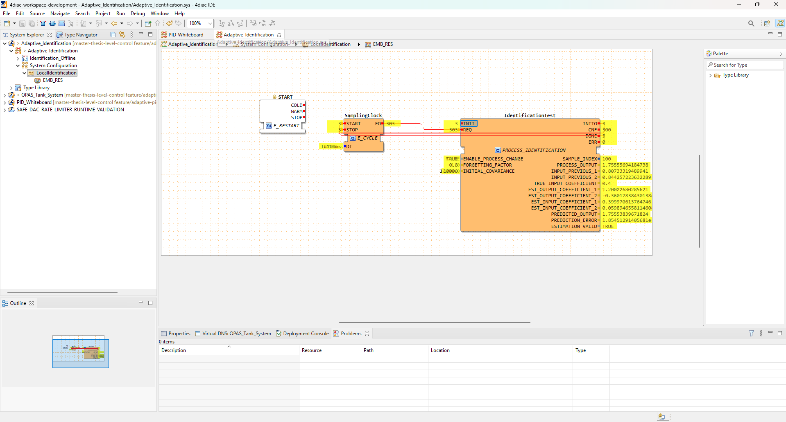

# Ensaio nativo: mudança do processo, esquecimento 0,8

Data: 19/10/2026. Evidência enviada pelo usuário no 4diac IDE, execução no FORTE local.

## Configuração e resultado

ENABLE_PROCESS_CHANGE=TRUE; FORGETTING_FACTOR=0.8; INITIAL_COVARIANCE=10000; SamplingClock.DT=T#100ms.

| Coeficiente | Valor verdadeiro após mudança | Estimativa final observada (arredondada) |
|---|---:|---:|
| EST_OUTPUT_COEFFICIENT_1 | 1.2 | 1.200226803 |
| EST_OUTPUT_COEFFICIENT_2 | -0.36 | -0.360178384 |
| EST_INPUT_COEFFICIENT_1 | 0.4 | 0.399970614 |
| EST_INPUT_COEFFICIENT_2 | 0.06 | 0.059894656 |

SAMPLE_INDEX=100; TRUE_INPUT_COEFFICIENT=0.4; ESTIMATION_VALID=TRUE.
Contadores cumulativos: INIT/INITO=3, CNF=300, DONE=3, ERR=0, REQ/EO=303. Portanto, o terceiro ensaio terminou; não são 300 amostras deste ensaio. A requisição adicional de cada execução sinaliza DONE sem novo cálculo.

Os quatro coeficientes finais concordam, na precisão apresentada, com a referência offline para este caso. O maior erro absoluto de coeficiente é aproximadamente 0.000226803. Com lambda=1 no ensaio anterior, era aproximadamente 0.398928975. A redução evidencia recuperação dos parâmetros neste experimento sintético determinístico; não prova superioridade universal de lambda=0.8.

O esquecimento reduz progressivamente o peso dos dados anteriores à mudança. ESTIMATION_VALID informa validade numérica, não uma certificação de exatidão do modelo.

## Alcance e próximo passo

Esta captura verifica o estado final e os contadores, não a trajetória nativa completa nem seu RMSE. Não há teste de planta física, sintonia de ganhos ou malha PID adaptativa neste ensaio. Próximo caso: manter a mudança e P0, alterar apenas FORGETTING_FACTOR para 0.6, disparar INIT uma vez e registrar o resultado.

