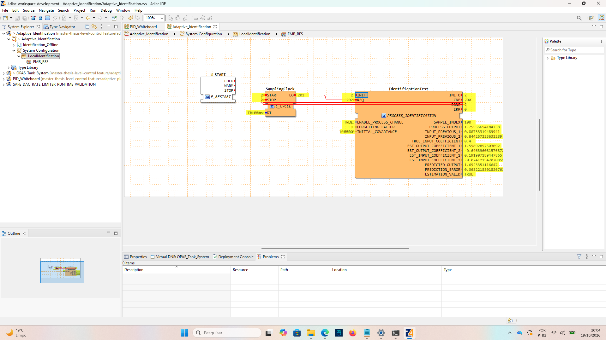

# Native changed-process test without forgetting

2026-10-19, user screenshot image(20261019-230506).png. Same composite-enabled runtime as the preceding fixed-process test. ENABLE_PROCESS_CHANGE=TRUE, FORGETTING_FACTOR=1.0, INITIAL_COVARIANCE=10000.0, DT=T#100ms.

Final SAMPLE_INDEX=100, TRUE_INPUT_COEFFICIENT=0.4, ESTIMATION_VALID=TRUE, ERR=0. Rounded coefficients [1.598928975, -0.646396082, 0.191907189, -0.074121547] agree with the archived offline changed-process/lambda=1 endpoint. PROCESS_OUTPUT approximately 1.755556942; PREDICTED_OUTPUT approximately 1.692335112; final one-step prediction error approximately 0.063221830 (not an RMSE).

Counters are cumulative over two runs: INIT/INITO=2, CNF=200, DONE=2, REQ/clock EO=202, clock START/STOP=2. The current replay index resets to 100 at completion; event monitoring counters did not reset. Relative to the preceding screenshot, this run adds 100 calculations and one completion.

The numerical algorithm completed correctly, but its coefficients are a poor estimate of the new process at this finite endpoint because the lambda=1 objective retains pre-change data. Numerical validity must not be treated as model acceptance for PID tuning. The true final coefficients are [1.2, -0.36, 0.4, 0.06]. Screenshot evidence does not replace a native full-trajectory comparison.

Next run: keep change enabled, set forgetting factor to 0.8, keep initial covariance 10000, and trigger INIT once after completion. Expected offline endpoint [1.200226803, -0.360178384, 0.399970614, 0.059894656]. Native forgetting-case results remain pending.
