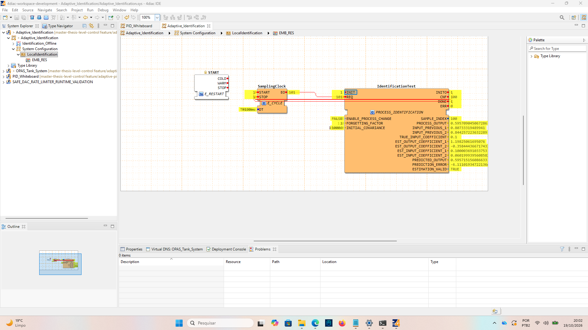

# Native fixed-process identification checkpoint

2026-10-19, user monitoring capture. Runtime build: [composite-enabled build](20261019-composite-build-result.md). Parameters: ENABLE_PROCESS_CHANGE=FALSE, FORGETTING_FACTOR=1.0, INITIAL_COVARIANCE=10000.0, SamplingClock.DT=T#100ms.

| Observed output | Rounded native value | Offline reference (same precision) |
|---|---:|---:|
| EST_OUTPUT_COEFFICIENT_1 | 1.198250617 | 1.198250617 |
| EST_OUTPUT_COEFFICIENT_2 | -0.358444367 | -0.358444367 |
| EST_INPUT_COEFFICIENT_1 | 0.100003691 | 0.100003691 |
| EST_INPUT_COEFFICIENT_2 | 0.060199940 | 0.060199940 |

SAMPLE_INDEX=100, CNF=100, INIT=1, INITO=1, DONE=1, ERR=0, ESTIMATION_VALID=TRUE. SamplingClock START=1, STOP=1, EO=101; IdentificationTest REQ=101. The extra request is expected: after processing 100 samples, the next request emits DONE without calculating another sample. This confirms completion and automatic stop for this run.

The rounded coefficients agree with the archived offline reference. This is screenshot-based endpoint evidence, not a full native trajectory comparison or physical-plant validation. The prediction-error number is clipped in the capture and is not transcribed. The process coefficients are estimated, not supplied as PID gains.

Next controlled comparison: enable the process change with forgetting factor 1.0; reinitialize only after completion. Then compare with forgetting factors 0.8 and 0.6 using the same input sequence and initial covariance. No rebuild is required for changing these input parameters. Model-to-PID tuning remains unconnected.
