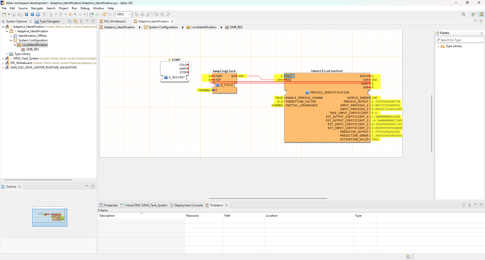

# Fechamento dos quatro ensaios nativos de identificação

Data: 19/10/2026. Ambiente: 4diac IDE 2.0.1 e FORTE local. Processo sintético; sem planta física.

## Quarto ensaio: mudança do processo, lambda=0.6

Captura fornecida pelo usuário: image(20261019-231150).png.
Configuração visível: ENABLE_PROCESS_CHANGE=TRUE, FORGETTING_FACTOR=0.6, INITIAL_COVARIANCE=10000, SamplingClock.DT=T#100ms.
Estado final: SAMPLE_INDEX=100; TRUE_INPUT_COEFFICIENT=0.4; ESTIMATION_VALID=TRUE.
Contadores cumulativos: INIT/INITO=4; CNF=400; DONE=4; ERR=0; REQ/EO=404; START/STOP=4.
São 100 amostras por execução, com uma requisição adicional para sinalizar o término.

| Saída | Valor verdadeiro após mudança | Valor nativo aproximado |
|---|---:|---:|
| EST_OUTPUT_COEFFICIENT_1 | 1.2 | 1.200000000216 |
| EST_OUTPUT_COEFFICIENT_2 | -0.36 | -0.360000000171 |
| EST_INPUT_COEFFICIENT_1 | 0.4 | 0.399999999968 |
| EST_INPUT_COEFFICIENT_2 | 0.06 | 0.059999999910 |

O resultado final concorda com a referência offline na precisão exibida. O maior erro absoluto de coeficiente é aproximadamente 2.16e-10. O expoente do campo PREDICTION_ERROR está cortado na captura; não foi transcrito nem usado para calcular RMSE.

## Síntese das evidências

| Caso | Maior erro absoluto final dos coeficientes, aproximadamente | Evidência |
|---|---:|---|
| Processo fixo, lambda=1 | 0.00174938 | [Ensaio 1](20261019-native-fixed-process.md) |
| Processo muda, lambda=1 | 0.398929 | [Ensaio 2](20261019-native-change-lambda1.md) |
| Processo muda, lambda=0.8 | 0.000226803 | [Ensaio 3](20261019-native-change-lambda08.md) |
| Processo muda, lambda=0.6 | 2.16e-10 | Captura acima |

Os erros resumem os estados finais registrados, com arredondamento. O fator 0.6 produziu o menor erro final neste processo determinístico e nesta sequência de entrada; isso não estabelece o melhor fator para uma planta real com ruído.

## O que está concluído e o que falta

Concluída a verificação funcional dos estados finais dos quatro casos de identificação no FORTE local, coerentes com as referências offline. As capturas não fornecem trajetórias nativas completas, avaliação de jitter, certificação IEC 61499 ou validação física.

O PID e o identificador foram ensaiados separadamente. Ainda falta a regra fundamentada que transforma os parâmetros identificados em ganhos do PID e sua integração por eventos. Os coeficientes estimados não são KP, KI e KD.

Próxima ação: preservar o projeto Adaptive_Identification mapeado pelo usuário e os dez arquivos C++/headers exportados. Os valores escritos online não devem ser presumidos persistidos no arquivo .sys. Depois, definir/documentar a regra de sintonia com base nos materiais, antes de conectar a adaptação.
