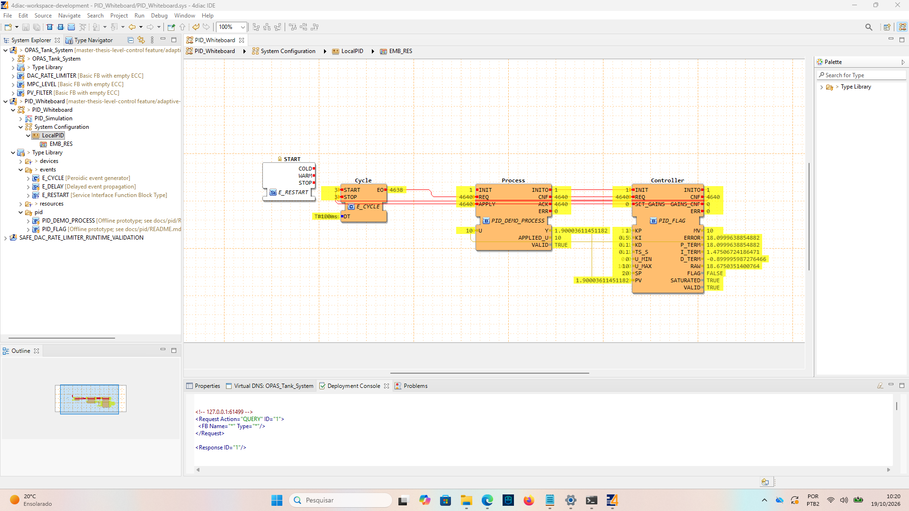
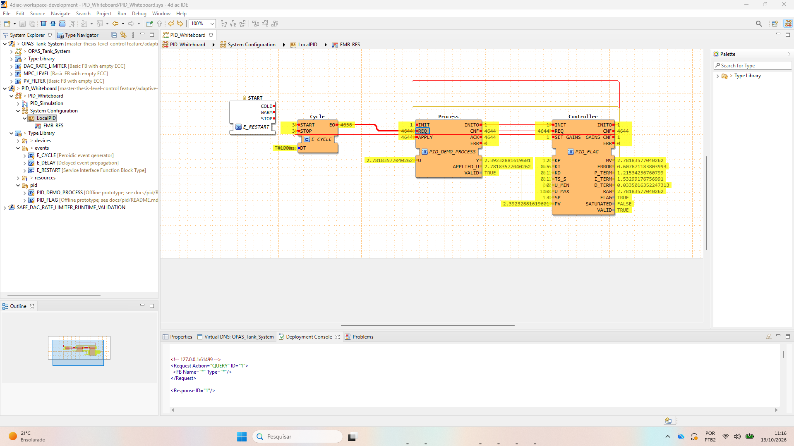

# Two useful native PID observations

User-supplied 4diac monitoring captures, 2026-10-19. The images are preserved
unchanged. The [functional checkpoint](20261019-native-functional-checkpoint.md)
contains the sequence and numerical observations; the
[mapped project checkpoint](20261019-mapped-project-checkpoint.md) records the
saved project. Online gain/reference changes are not assumed to be saved defaults.

## Saturation and the previous-cycle flag

On the second manual request at SP=20, MV remains at the upper limit 10 and the
integral contribution remains 1.475067242. The previous cycle's FALSE flag freezes
integration. This documents the implemented delayed flag, not universal anti-windup
performance; the known freeze limitation remains relevant.

## Gain update used on the following request

After SET_GAINS latched Kp=2, the next request gives error approximately 0.607671184,
P=1.215342368 and MV=2.781835770. SET_GAINS itself did not calculate a new command
or reset integral memory. This is a manually supplied gain update, not adaptive tuning.

Next: [separate MMQE validation](../adaptive/20261019-mmqe-next-step.md).
